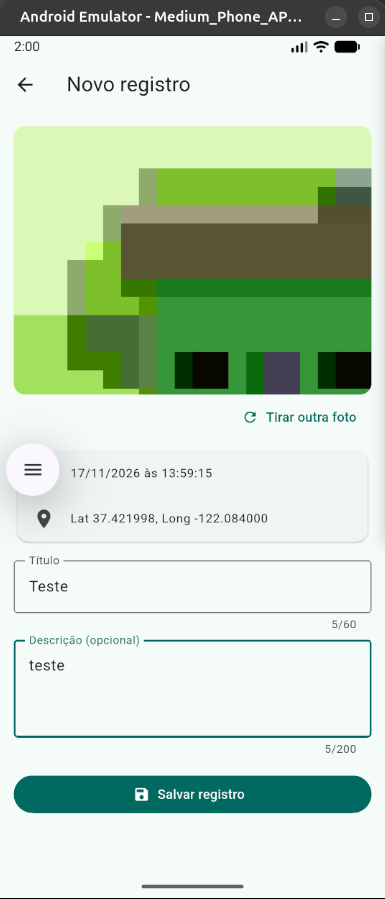
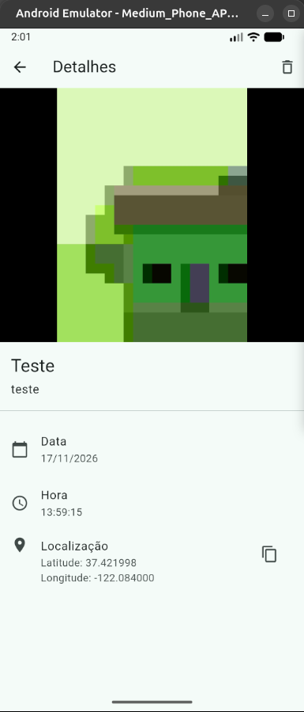

# GeoDiário

GeoDiário is a Flutter app for recording photos together with the date, time and GPS location where they were taken. The user takes a picture, adds a title and a short description, and the record is stored locally with SQLite. Records can be browsed in a gallery, opened to see the photo and its details, and deleted.

## Features

- **Photo capture (RF01)**: opens the device camera as soon as a new record is started, with an option to retake the photo.
- **Automatic metadata (RF02)**: date and time are recorded at the moment of capture, and latitude/longitude are read from the GPS. The user adds a title (required) and a description (optional).
- **Local storage (RF03)**: the image file is copied to the app's documents folder (`fotos/`), and SQLite (sqflite) stores the file path plus all the other information.
- **Gallery (RF04)**: home screen shows every record in a two-column grid, newest first, with pull-to-refresh.
- **Details and deletion (RF05)**: tapping a record shows the full photo, title, description, date, time and coordinates (with a button to copy them). Deleting asks for confirmation and removes both the database row and the image file.
- **Error handling**: handles GPS turned off, denied location permission, GPS timeout (falls back to the last known position) and missing image files.

## Tech Stack

- Flutter / Dart
- [`image_picker`](https://pub.dev/packages/image_picker): camera capture
- [`geolocator`](https://pub.dev/packages/geolocator): GPS coordinates and location permissions
- [`sqflite`](https://pub.dev/packages/sqflite): SQLite database
- [`path_provider`](https://pub.dev/packages/path_provider): app documents folder for storing photos
- [`path`](https://pub.dev/packages/path): building file paths

## Database Schema

Database `geodiario.db`, table `registros`:

| Column | Type | Description |
|---|---|---|
| `id` | INTEGER PRIMARY KEY AUTOINCREMENT | Record identifier |
| `titulo` | TEXT NOT NULL | Title typed by the user |
| `descricao` | TEXT | Optional description |
| `caminho_foto` | TEXT NOT NULL | Path to the image file on the device |
| `data_hora` | TEXT NOT NULL | Date and time of capture (ISO 8601) |
| `latitude` | REAL NOT NULL | GPS latitude |
| `longitude` | REAL NOT NULL | GPS longitude |

## Project Structure

```
lib/
├── main.dart                      # App entry point and theme
├── models/registro.dart           # Record model (toMap / fromMap)
├── database/database_helper.dart  # SQLite: create table, insert, list, find, delete
├── services/photo_service.dart    # Camera capture and image file storage
├── services/location_service.dart # GPS and permission handling
├── screens/home_screen.dart       # Gallery of records
├── screens/novo_registro_screen.dart # New record (photo + GPS + title)
├── screens/detalhes_screen.dart   # Record details and deletion
├── widgets/registro_card.dart     # Gallery card
├── widgets/foto_registro.dart     # Image widget with fallback
└── utils/formatters.dart          # Date, time and coordinate formatting
```

## Screenshots

| Gallery | New record | Details |
|---|---|---|
|  |  |  |

## Getting Started

1. Install Flutter (3.24 or later) and connect an Android device or start an emulator.
2. Clone the repository and enter the folder:
   ```bash
   git clone https://github.com/LaurVieira/geodiario.git
   cd geodiario
   ```
3. Generate the platform folders (existing files are kept):
   ```bash
   flutter create --org com.example --project-name geodiario --platforms android,ios .
   ```
4. For iOS only, add these keys to `ios/Runner/Info.plist`: `NSCameraUsageDescription`, `NSLocationWhenInUseUsageDescription` and `NSPhotoLibraryUsageDescription`.
5. Install the dependencies and run the app:
   ```bash
   flutter pub get
   flutter run
   ```

## Author

Laura Vieira - [@LaurVieira](https://github.com/LaurVieira)
